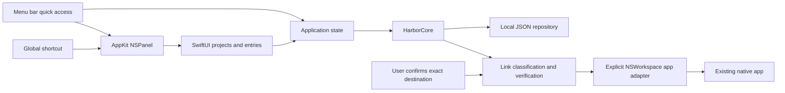

# Architecture

## Layers

`HarborCore` is a Foundation-only library for projects, entries, verification records, editing, undo, format versions, and storage. Tests use temporary directories and fictional links.

`HarborApp` owns the menu bar, floating window, global shortcut, forms, preferences, localization, and native opening. Link policy stays separate from presentation so a future supported cloud route does not require redesigning the project list.

## Menu bar quick access

The compact menu-bar panel and the full workspace share the same application model, preferences, library and undo history. The panel projects favorites in stored order and provides project navigation. It never creates another library or verification path. Confirmed native entries can open directly; entries requiring attention return to the workspace. The menu-bar window closes before workspace actions, while the complete workspace keeps its established keyboard behavior.

The visible name is optional and stored separately from workspace data. Missing name-visibility preferences upgrade to showing the localized name. The compact panel has no search field, so opening it cannot implicitly enter search mode.

## Opening a link

1. Store the original URL and classify it without rewriting its scheme or guessing its target.
2. Allow explicit native testing for a valid local Codex route. Show an explanation for unsupported cloud or other links.
3. Address the designated native application explicitly through `NSWorkspace`.
4. Treat system acceptance as a pending test, not proof of the correct destination.
5. Save a local verification record only after the user confirms the conversation.
6. Require confirmation again if the URL or native application version changes.

A completion callback, running process, or registered scheme cannot establish the exact destination.

## Storage and transactions

The default directory is `~/Library/Application Support/HarborWorkspaceDock/`. `workspace.json` contains project titles, entry metadata, URLs, ordering, and verification records. It contains no conversation text, login state, or credentials.

Schema-versioned JSON is replaced atomically. A read failure or unsupported version blocks writing and preserves the original file. The in-memory view updates only after a successful save. Run one instance at a time; concurrent-writer protection is planned.

`WorkspaceEditing` deletes, moves, and reorders by stable ID. Moves preserve the complete entry and append it to the destination. Reordering only changes array positions. The workspace remains schema 1.

`WorkspaceSession` holds up to 50 snapshots of successful library mutations during a run. Add, edit, favorite, verify, delete, move, and reorder all use the same history, preventing an older snapshot from discarding a later change unexpectedly. Undo saves before popping history; failure leaves both current state and history intact. History is cleared on quit and is not a persistent trash.

## Drag and drop

An own-process data type carries per-session and per-drag identifiers. Hovering shows insertion feedback but does not save. One accepted drop performs one transaction. Row reordering requires the original project and no active search or Favorites filter. Cross-project movement targets real sidebar projects. Menu commands provide equivalent operations without dragging.

## Preferences and language

`preferences.json` is separate from the library. Appearance, accent, density, starting view, language, and menu-bar name visibility persist only after a successful save. New preferences default to English; earlier preferences without a language field decode as Simplified Chinese. Switching languages updates interface text while preserving user content. Preferences do not enter library undo history.

Corrupt, future-version, or unwritable preference files retain the same protective behavior as the library.

## Login launch

`SMAppService.mainApp` provides login registration on macOS 13+. Settings reads the system state directly; only `enabled` is displayed as enabled. Registration requires a stable installed path and is blocked in isolated-data test mode. A login launch stays in the menu bar; a manual launch shows the panel. A real logout/login remains a separate manual check.

## Packaging and future boundaries

Open `Package.swift` in Xcode, or build with the included shell scripts. The build produces a standard `.app` with an ad-hoc signature; it does not install, register login launch, publish, or notarize the app.

Future import/export must validate schemas and re-evaluate imported verification records. Additional link routes require a documented policy and exact-destination confirmation. Shortcut customization can be added independently of the always-available menu-bar entry.
