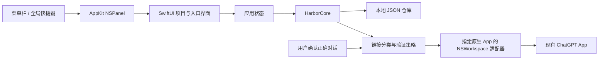

# 架构

## 核心分层

`HarborCore` 是无 UI 的 Foundation 库，管理分组、入口、验证记录、格式版本和磁盘保存。测试可以在临时目录运行，不读取真实聊天数据。

`HarborApp` 承担菜单栏、浮动窗口、快捷键、表单与原生打开服务。SwiftUI 与业务规则分离，未来新增受支持的云端路由时，无需重写项目列表。

## 打开流程

1. 保存用户原始链接，解析其类别和目标，不修改 scheme 猜测。
2. 合法本地 Codex 链接可进入「测试原生打开」；普通云端及不支持的链接保留说明。
3. 发送时显式指定原生 App，而非交给可能改变的默认浏览器。
4. 系统接受后仅记录一次待确认测试。
5. 用户确认标题与目标对话正确后，保存本机验证记录。
6. 以后点击直接打开；URL 或 App 版本变化会要求重新验证。

精确落点不能通过 `NSWorkspace` completion 回调证明。不能把“App 启动了”“进程存在”“URL handler 已注册”写成“对话成功打开”。

## 本地数据

默认目录：`~/Library/Application Support/HarborWorkspaceDock/`。存储项目标题、入口名称、链接、排序与验证元数据；没有消息正文、登录态或账号密钥。

JSON 带 schemaVersion。写入采用原子替换；读取失败或未知新版本时禁止覆盖。应用状态只在保存成功后更新，避免界面显示已保存而重启丢失。多实例同时修改属于后续稳定性范围；首版按单进程使用。

## 为什么用 Swift Package

可以直接在 Xcode 打开 `Package.swift`，也可无 IDE 构建核心与应用。打包脚本生成标准 `.app`，本地临时签名用于本机运行；没有承诺已公证、可直接分发给其他 Mac。

## 下一阶段接口边界

- Import/Export 在仓库层验 schema 和数据引用，不直接信任外部验证标记。
- 更多链接类型通过独立策略增加；默认禁止陌生 scheme。
- 登录启动已使用 macOS 13+ 的 `SMAppService.mainApp`，只把 `.enabled` 呈现为开启；安装路径与隔离测试模式受到检查。
- 快捷键配置只替换 HotkeyManager；菜单栏始终保留为备用入口。

## 偏好与登录启动

外观、点缀色、密度和默认视图使用独立 `preferences.json`，不改入口文件或其 schema。偏好保存成功后才更新视图；损坏、未来版本或写入失败会保留原文件并给出提示。

登录启动不存为一个自报成功的布尔值，而是直接读取 macOS 服务状态。命令入口支持显式注册、注销与状态检查；隔离测试模式不能修改登录项。正常手动启动显示面板，识别到系统登录启动事件时保持菜单栏待命。
